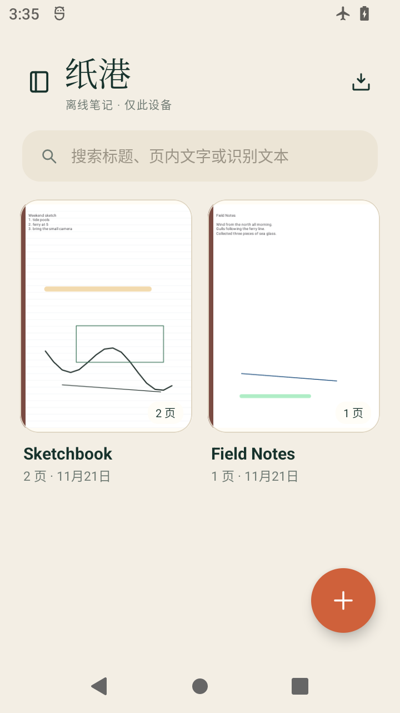
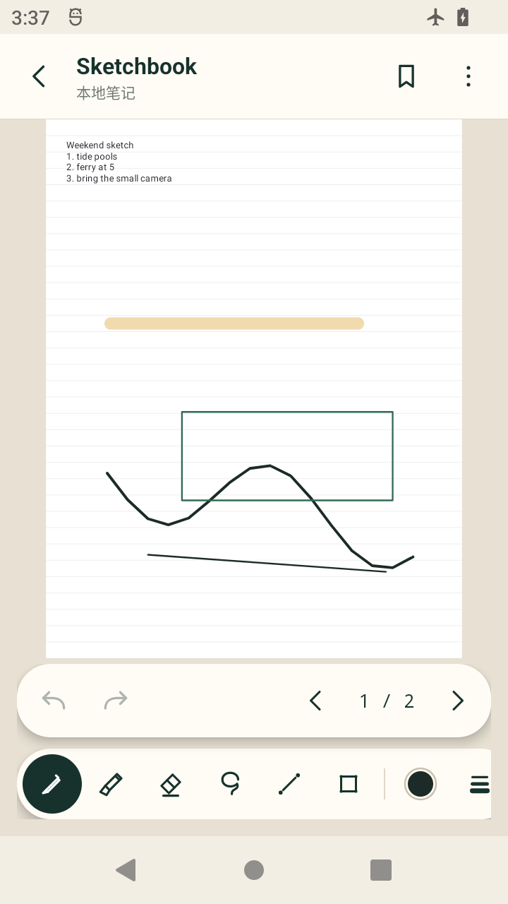
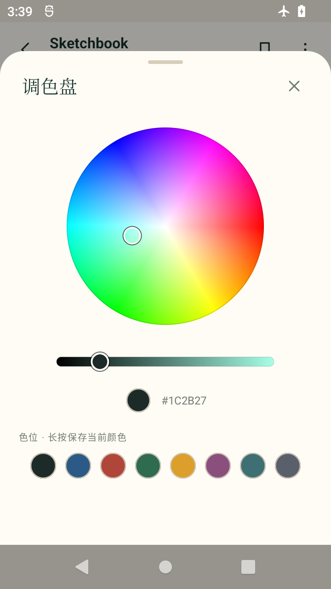

# 纸港 · PaperHarbor

一款不需要账号、网络或 API Key 的 Android 笔记本。界面以图标为主：书架用封面缩略图展示笔记，编辑器是可收起的图标工具栏，调色盘提供色轮、亮度和可长按保存的色位，笔尖粗细带有实时笔触预览。所有笔记、识别文本和录音都只保存在应用私有目录；应用不声明 `INTERNET` 或 `ACCESS_NETWORK_STATE`。支持 Android 8.0（API 26）及以上。

| 书架 | 编辑器 | 调色盘 |
|---|---|---|
|  |  |  |

## 功能

- **书架**：封面缩略图、标题与页数、页内文字搜索、导入 PDF/图片/备份。长按笔记可重命名、导出 PDF、备份或删除。
- **书写**：画笔、荧光笔、橡皮擦、套索、直线、矩形，触控笔压感、双指平移缩放、撤销/重做。工具栏用原创矢量图标，选中状态清晰。
- **调色盘**：色相/饱和度色轮与亮度滑杆；8 个可长按保存的色位，以及最近使用颜色。选色即时生效。
- **笔尖**：滑杆和四个尺寸预设，上方实时预览当前颜色与粗细；橡皮擦使用同一面板调整大小。
- **页面**：缩略图页面网格、当前页高亮、书签标记；添加横线/方格/空白页，复制、前后移动或删除页面。
- **资料导入**：从本地导入 PDF 或图片，在原页面上批注。页内可添加键入文字；离线 OCR 支持横排简体中文与英文的印刷文字，识别结果可核对后保存并参与书架搜索。
- **学习与录音**：双面闪卡、自评复习；只在主动点击时申请麦克风，录音保存在本机，可回听或删除。
- **本地备份**：`.phnote` 是可编辑备份，包含笔迹、文字、闪卡和录音；在书架导入后恢复为新笔记，不覆盖原件。换设备时请自行拷贝备份。

**卸载前请自行在本地导出备份。** 没有后台云备份；`.phnote` 不加密，含笔记和录音，请自行妥善保管。系统选文件时使用 `EXTRA_LOCAL_ONLY`，但无法控制用户之后用其他应用分享已导出的文件。

## 边界

独立实现，与 Goodnotes 无从属或授权关系。没有使用原 IPA 的代码或素材，不读取或继承任何订阅。**不导入 `.goodnotes` 私有笔迹文档**；旧资料可先导出为 PDF 再批注。不提供账号、云同步、多人协作、内容商店、远程 AI、Office 转换、笔迹同步录音回放或语音转写。普通 PDF 导出会把页面和批注合成，不能替代可编辑备份；OCR 文本不会作为隐藏文字层写入导出的 PDF。界面图标为本项目原创的矢量资源。

## 安装与签名

从仓库 Releases 下载 `PaperHarbor-0.2.0-debug.apk` 可直接侧载，使用测试签名，包名 `app.paperharbor.notes.debug`。`PaperHarbor-0.2.0-unsigned.apk` 是待**自行签名**的正式构建，包名 `app.paperharbor.notes`，未签名时不能安装。两者可并存但不共用数据，请用 `.phnote` 迁移笔记。

正式密钥只在自己的电脑生成、备份和使用；不要上传 keystore，密码由签名工具交互式读取。

```powershell
keytool -genkeypair -keystore D:\PrivateKeys\paperharbor.jks -alias paperharbor -keyalg RSA -keysize 3072 -validity 10000
```

```powershell
.\tools\sign-local.ps1 -Keystore D:\PrivateKeys\paperharbor.jks -Alias paperharbor -Unsigned .\PaperHarbor-0.2.0-unsigned.apk
```

首次命令需要目标目录已经存在。脚本不存密码，不向任何网站发送文件；会验证签名、输出成品 SHA-256，并拒绝覆盖现有成品。后续更新应继续使用同一签名证书。

## 构建与复验

需要 JDK 17 或 21、Android SDK Platform 34、Build Tools 34 和可用的 Android SDK 路径（`ANDROID_HOME` 或本机 `local.properties`）。Gradle 包装器固定 8.9 并校验发行包摘要。首次准备构建工具/Android Gradle Plugin 可能需要联网；**这不是 APK 的运行要求**。构建工具缓存就绪后：

```powershell
.\gradlew.bat --offline assembleDebug assembleRelease assembleDebugAndroidTest
```

```powershell
python -I .\tools\verify-apk.py .\app\build\outputs\apk\debug\app-debug.apk --build-tools "$env:ANDROID_HOME\build-tools\34.0.0"
```

仪器测试使用合成笔记：笔迹提交/撤销、可编辑备份恢复、PDF 导出后独立重读和像素核对、随包 OCR、最终权限。可在专用 Android 测试设备上运行 `connectedDebugAndroidTest`；`tools/offline-smoke.py` 测飞行模式下的界面操作、强停重启和搜索，`tools/layout-check.py` 检查横竖屏书写和 360 dp 布局。真机自动化会创建并删除带唯一名称的合成笔记，须由设备所有者明确同意（`--allow-device`），不要在别人的个人资料上运行。验收记录见 [`docs/verification-0.2.0.md`](docs/verification-0.2.0.md)。

第三方 OCR 引擎、语言数据及其依赖适用各自许可，见 `app/src/main/assets/ocr/NOTICE.txt` 与 `licenses/`。本仓库不包含真实用户笔记、录音、签名密钥或原 IPA。
